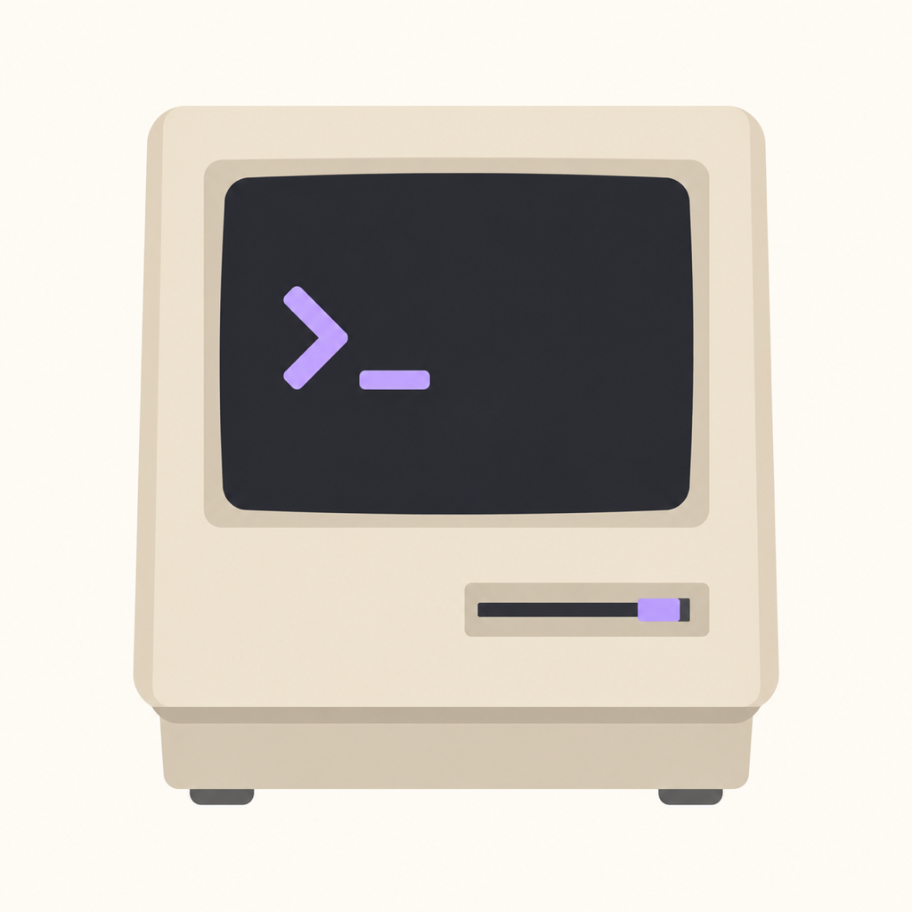
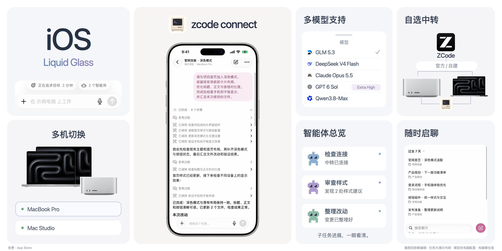
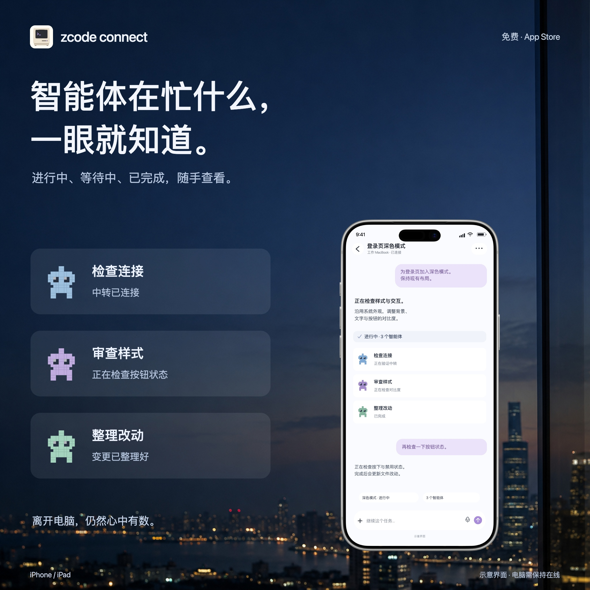

<h1 align="center">Zcode Connect</h1>

电脑上的 AI 任务，随身继续。

<strong>简体中文</strong> · <a href="README.en.md">English</a>

<a href="https://apps.apple.com/app/id6820455082">在 App Store 免费下载</a> · <a href="https://github.com/PacoZhou1/zcode-connect/issues">反馈问题</a>

## 这是做什么的？

电脑上的 AI 任务还在跑，你却要出门了。

Zcode Connect 让你在 iPhone 或 iPad 上连接电脑里的 ZCode，看看任务进展、接着聊几句、检查文件改动。任务仍然在电脑上运行，手机是你随身带着的操作入口。

这是一个独立开发的原生 iOS 客户端，采用 Liquid Glass 设计，不是 Z.ai 官方产品。

## 你可以用它做什么

- **随时接着做**：打开已有项目和任务，继续对话，查看回复与执行步骤。
- **切换多台电脑**：保存不同电脑的连接，按需要切换。
- **看看智能体在忙什么**：查看子智能体的进展和对话，了解任务如何推进。
- **查看文件和改动**：浏览项目文件，检查任务产生的变更。
- **沿用你的模型配置**：模型和可用选项来自连接的电脑，不需要在手机上重新搭建一套环境。
- **选择连接方式**：使用 ZCode 官方中转，或由有部署经验的用户配置自己的中转服务器。

App 支持简体中文、英语、日语、法语、韩语和德语，默认跟随系统语言，也可以在设置中单独切换。

## 开始使用

1. 从 [App Store](https://apps.apple.com/app/id6820455082) 安装 App，需要 **iOS / iPadOS 26 或更新版本**。
2. 在电脑上准备 [ZCode](https://zcode.z.ai/)。使用支持远程连接的桌面版本，并打开它的远程连接入口。
3. 在手机上扫码或粘贴完整配对信息，核对电脑和中转地址，确认连接。
4. 选择项目，打开任务，就可以继续了。

**电脑需要保持开机、联网，ZCode 也需要运行。** App 本身免费；你选择的模型或第三方服务可能另行计费。请不要把配对二维码或链接发给别人，它们包含连接凭据。

没有自己的服务器也可以使用官方中转。自建中转是面向有服务器和部署经验的用户的进阶选项，需要单独配置；仅下载本仓库不会自动完成桌面或服务器部署。

## 看看实际使用场景

<table><tr>
<td></td>
<td></td>
<td></td>
</tr></table>

宣传图中的项目名、聊天和任务内容都是公开演示示例。Bento 的对话与首页基于截图进行脱敏编辑；模型列表用于说明配置方式，不表示每个模型都默认可用。

## 想研究源码？

普通用户直接安装 App 即可，不需要编译。想自行构建、部署或参与开发，请看 [开发说明](docs/DEVELOPMENT.md)。

仓库正在进行开源前整理；现有源码快照与 App Store 版本不保证一一对应。安全与公开准备状态见 [开源前审查](docs/security/OPEN_SOURCE_REVIEW_20261017.md)。正式开源许可证尚待确认，不把“可以看到代码”等同于已获得开源许可。

## 联系与反馈

发现问题可以提交 [Issue](https://github.com/PacoZhou1/zcode-connect/issues)，说明 App 版本、电脑端版本和复现步骤；截图和日志请先去掉配对信息及私人内容。

支持邮箱：**3141791843@qq.com**。安全问题请通过邮箱私下联系，参见 [安全说明](SECURITY.md)。
